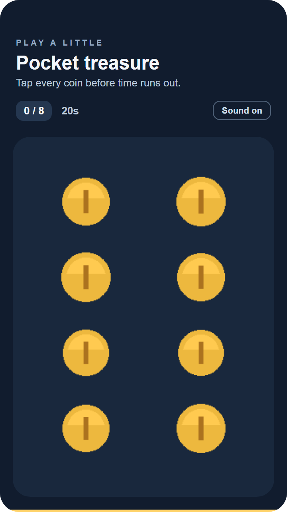
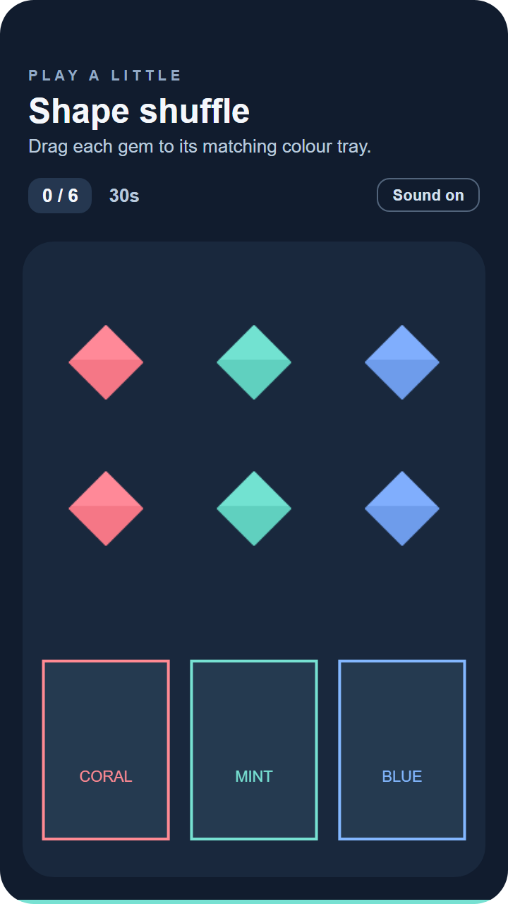

# PlayableAds

[](https://github.com/ArchageXIII/PlayableAds/actions/workflows/ci.yml)

A small Canvas 2D toolkit for authoring playable ads directly or with a coding agent. Write gameplay once; export a single Unity HTML file and a Google App campaign ZIP for Android and/or iOS. 3D and WebGL are not supported.

Source: [ArchageXIII/PlayableAds](https://github.com/ArchageXIII/PlayableAds). Clone the repository to author games locally; no npm package or hosted service is required. Coding agents that can edit files and run local commands can follow the included briefs and instructions, and developers can also edit the TypeScript directly. Point your agent to [AGENTS.md](AGENTS.md) and the [authoring guide](docs/authoring.md); automatic instruction discovery varies between agents.

## Demo games

Local previews at 360 × 640, captured at double resolution. Click an image to view it full size. These previews do not establish platform or device verification.

| Pocket treasure | Shape shuffle |
| :---: | :---: |
| [](docs/screenshots/tap-to-collect.png) | [](docs/screenshots/drag-to-sort.png) |
| Tap eight coins before the 20-second timer expires. | Drag six gems into matching trays within 30 seconds. |

## Run the playable lab

Requires Git and Node.js 22.14 or newer (Node 22 is used in CI). Start with:

```sh
git clone https://github.com/ArchageXIII/PlayableAds.git
cd PlayableAds
```

On Windows PowerShell, use `npm.cmd` and `npx.cmd`:

```powershell
npm.cmd ci
npx.cmd playwright install chromium firefox webkit
npm.cmd run build -- --all --mode preview
npm.cmd run dev
```

On macOS/Linux:

```sh
npm ci
npx playwright install --with-deps chromium firefox webkit
npm run build -- --all --mode preview
npm run dev
```

Playwright's Linux system-dependency installation may request administrator access. In later examples, use `npm` instead of `npm.cmd` on macOS/Linux. Stop a foreground server with Ctrl+C; the background start/stop scripts below are Windows-only.

Open **http://127.0.0.1:5173/**. Choose Pocket treasure or Shape shuffle, a host, and an OS. SDK readiness, visibility, viewport sizes, audio status and intercepted install calls are available in the lab. An opaque-origin, scripts-only iframe models Google's sandbox. The browser host is development-only. Reload to reset host/game state.

On Windows, after dependencies are installed, start and stop the lab with no arguments:

```powershell
.\start.ps1
.\stop.ps1
```

`start.ps1` runs the server in the background, reuses an existing healthy project preview, and tries ports 5173–5193 if another application occupies the default. Use the URL it prints. `stop.ps1` identifies this project's process before stopping it, including a server started manually with `npm.cmd run dev`; it leaves unrelated processes alone. Both scripts work from any working directory and serialize simultaneous start/stop operations. State and logs live in the ignored `.cache/preview-server` folder. If a managed process becomes unhealthy, stop it before restarting. To use `Check built artifacts` in the lab, build preview exports first as shown above.

The Windows lifecycle integration check is `& .\tests\server-control.ps1`. It stops the project preview, requires ports 5173/5174 to be free, exercises an unrelated collision fixture and stale PID protection, and leaves the preview stopped.

Both sample games have embedded, code-authored PNG artwork. Pocket treasure requires eight taps within 20 seconds. Shape shuffle requires six correct drops within 30 seconds. The clock starts on the first gameplay gesture. Both have win/loss states, replay, sound controls, and install buttons.

## Optional Codex plugin

Codex users can install the **PlayableAds** plugin for guided setup, game authoring and export verification. It supports a fresh checkout or an existing project and uses the same toolkit commands and project documentation. The plugin is optional; no MCP server or advertising-account connection is required.

See the [Codex plugin guide](docs/codex-plugin.md) for desktop and CLI installation, example prompts, updates and removal. Plugin updates refresh the workflows; they do not upgrade or overwrite your game project.

## Create a game

```powershell
npm.cmd run create-game -- --id my-game --template tap
# Or: --template drag
npm.cmd run dev -- --game my-game
```

Fill in `games/my-game/brief.md`, then edit `game.ts`, `game.config.json` and local assets. Use the reference games and [authoring guide](docs/authoring.md). The scaffolder refuses to overwrite existing games. Templates are copied from the maintained reference games.

The brief also captures the advertised app, destinations, platforms/OS, campaign objective, languages, CTA copy/timing and Google campaign setup. Reuse known answers and mark unknown release details **pending** during preview work. See the [destination and CTA workflow](docs/authoring.md#destination-and-cta-workflow) before preparing a release.

Game modules implement `createGame(context)` and `update`, `render`, `resize`, `onInput`, and `dispose` hooks. Runtime services own host readiness, visibility, timers, input normalization, artwork loading, optional audio, end cards and CTAs. Game imports are limited to local modules and shared runtime types/math. Use PNG/JPEG images and optional WAV audio; assets are embedded by the exporter. No runtime engine dependency or CDN is required.

## Build and verify

```powershell
npm.cmd run build -- --game my-game --mode preview
npm.cmd run verify -- --game my-game
npm.cmd run check
```

Each selected OS produces:

- `dist/<game>/<os>/unity/index.html`
- `dist/<game>/<os>/google/playable.zip`, containing only `index.html`
- `dist/<game>/report.json`, outside upload bundles

Reports include sizes, asset contributions, SHA-256 hashes, source fingerprints, build mode, local checks, and pending platform acceptance. Verification rechecks the files and reproduces their bytes from current sources; stale or edited artifacts fail. The 4,500,000-byte ceiling applies to HTML as well as ZIP output. This is our internal budget, below published platform limits.

**Preview builds use intentionally invalid sample app destinations for intercepted local CTA testing. They do not qualify as release builds or platform-approved ads.** Google uses campaign destination routing; the sample destination is used by the Unity mock. Supply your own app destinations before preparing a release.

For release, copy `release.config.example.json` to the ignored `release.config.json`, replace sample values with your app's actual URLs, then run:

```powershell
npm.cmd run build -- --game my-game --os android,ios
npm.cmd run verify -- --game my-game
```

Build defaults to **release** and fails without real-format, non-placeholder store URLs. Omit `--os` to build the operating systems present in your release configuration. URL checks validate format and reject known placeholders; the manual platform check must establish that the app exists and matches the campaign. Configuration can be shared or supplied with `--config path/to/file.json`. Google destination setup is performed in Google Ads, never through a direct link in gameplay.

Unity embeds the configured store URL and calls `mraid.open(url)`; changing it requires a rebuild. Google calls `ExitApi.exit()` without supplying a URL, so campaign routing is checked separately. Custom listings and in-app destinations require platform setup; Google deep links also require app support. Website destinations need a separately scoped campaign/export approach. Complete the brief's destination checklist and record actual CTA observations before release; these authoring questions add no config fields or build gates.

## Verification status

`npm.cmd run check` runs type checking, tooling tests, preview exports, source/hash verification, and Chromium/Firefox/WebKit tests against the actual exported HTML and ZIP contents. Google SDK calls are intercepted; Unity's host is simulated. The runtime tests cover sandbox origin, gameplay, incorrect drops, rotation, replay, loss, host readiness, pause/resume, gesture gating, audio failure, missing SDKs and network traffic. Preview UI tests exercise the lab itself.

GitHub Actions runs the full suite on Ubuntu and the server lifecycle checks on Windows for pushes to `main`, pull requests and manual runs. Successful runs retain preview exports and validation reports for 14 days; available browser reports and failure traces are retained for 14 days as well. Download them from the run's Actions page (GitHub sign-in is required). Release configuration is not committed. CI never uploads creatives or launches campaigns.

Local checks are technical evidence, not platform certification. Preliminary Google upload/preview and maintainer-reported Unity upload checks were completed in October 2026. They do not qualify newly built artifacts for release. Real destination/device verification and legacy-device checks remain pending. Follow [the platform check guide](docs/platform-checks.md). Modern Playwright engines cannot prove compatibility with Android 4.4/iOS 9, even though production JavaScript is ES5 and the runtime uses feature fallbacks.

See [platform requirements and sources](docs/platform-requirements.md) for the current documentation baseline and [the game brief](docs/game-brief.template.md) for new ideas.

## Contributing and license

See [CONTRIBUTING.md](CONTRIBUTING.md) for development checks and pull requests. The toolkit and included sample code/artwork are available under the [MIT license](LICENSE), copyright 2026 Magicave Holdings Limited. Dependencies retain their own licenses.

Exports include the full MIT notice in a non-rendered HTML comment because they contain the toolkit runtime. Keep this notice when distributing modified exports. Your own added game code and artwork can have their own terms. The repository remains marked `private` in package metadata to prevent accidental npm publication; this does not restrict cloning or using the public GitHub source under MIT.
